# cuBBS-Cred GPU Backend Design — ABI v2

This document describes the current implementation. Historical ABI v1 route
numbers and exploratory profiling notes are intentionally excluded; Git history
and timestamped benchmark artifacts remain the source for historical results.

Protocol equations are maintained in [BBS four operations](bbs-four-operation-cryptography.zh-CN.md),
and HTTP-specific queues/caches in [W3C service](w3c-service.md).



## 1. Architectural Boundary

The public backend exposes Sign, Verify, ProofGen, and ProofVerify. These are
protocol operations, not four monolithic CUDA kernels. The CPU host validates
and groups requests, maintains protocol state, materializes device buffers, and
finalizes encoded signatures or proofs. The GPU executes the arithmetic-dense
Hash-to-Scalar, MSM, and eligible pairing stages.

```text
BBS requests
  -> CPU validation and compatibility batching
  -> operation-aware planner IR
  -> H2S engine | MSM engine | pairing engine
  -> CUDA queues and streams
  -> CPU protocol finalization and result ordering
```

MSM Route 1–8 exists only inside the MSM engine. H2S and pairing never select
an MSM route.

## 2. Planner Compatibility and Jobs

The planner groups requests by:

- BBS operation;
- total message count;
- disclosed-index layout;
- a BBS-header context digest for Sign and Verify.

Public-key equality is tracked separately for pairing prepared-state reuse. It
does not define the MSM compatibility key. Presentation headers are protocol
inputs but do not currently split planner batches.

The planner describes three execution engines. MSM additionally records its
point layout:

- `HashToScalar`: message and transcript byte strings mapped into `Fr`;
- `Msm/CommonPoints`: rows share one G1 point vector and vary only in scalars;
- `Msm/VariablePoints`: each item carries proof- or signature-specific points;
- `Pairing`: verification equations, with metadata indicating whether the
  public-key context is common across the request set.

Common-points and variable-points are layouts of the same MSM engine, not
separate top-level engines.

## 3. Protocol Lowering

Let `L` be total messages, `R` disclosed messages, and `U = L - R` hidden
messages. The planner term model follows the protocol lowering implemented in
`cubbs-bbs-protocol`:

| Operation | Lowered arithmetic jobs |
|---|---|
| Sign | H2S; common-points `B` MSM with `L + 2` terms |
| Verify | H2S; common-points `B` MSM with `L + 2` terms; one pairing equation |
| ProofGen | H2S; common-points `B` MSM with `L + 2` terms; variable-points T2 MSM with `U + 1` terms (`B` plus hidden generators) |
| ProofVerify | H2S; three-term variable-points T1 MSM; common-generator T2 component with `L + 2` terms; one-term variable `D` component; one pairing equation |

The table describes algebraic lowering, not a promise that every row produces a
separate kernel launch. Specialized kernels may fuse compatible sub-jobs while
preserving the same equations and term counts.

## 4. MSM Route Registry

The ABI v2 registry is:

| Route | Implementation | Device | Selection |
|---:|---|---|---|
| 1 | cuBBS-Cred specialized/fused item MSM | CUDA GPU | production |
| 2 | cuBBS-Cred tuned common-points MSM | CUDA GPU | production |
| 3 | cuBBS-Cred large-shape tiled MSM | CUDA GPU | production |
| 4 | cuBBS-Cred bounded universal item/common fallback | CUDA GPU | production |
| 5 | BLST item MSM | CPU | explicit fallback/benchmark |
| 6 | BLST common-points MSM | CPU | explicit fallback/benchmark |
| 7 | SPPARK item Pippenger reference | CUDA GPU | optional reference build |
| 8 | SPPARK common-points reference | CUDA GPU | optional reference build |

Normal GPU execution selects only Routes 1–4. An untuned or oversized shape
falls through to Route 4; it is not silently relabeled as BLST or SPPARK work.
Routes 5–8 exist for explicit fallback and comparative benchmarks. See
[MSM production routes — ABI v2](msm-route-production-design-v2.zh-CN.md) for build switches and
failure policy.

## 5. CUDA Execution Structure

Route selection depends on point layout, term count, output-row count, and
bounded workspace/cache policy:

- specialized item work enters Route 1;
- compatible same-generator scalar matrices enter Route 2;
- tuned large common-point shapes enter Route 3;
- arbitrary variable-point and untuned/ultra-large common-point shapes enter
  the resource-bounded Route 4 implementation.

CUDA queues and streams overlap compatible H2S, MSM, pairing, transfer, and
host-finalization work. Batch sizes are execution-policy inputs rather than ABI
limits: oversized batches are grouped and chunked under memory budgets, then
results are restored to the original request order.

## 6. Open-Source Boundaries

cuBBS-Cred implements the planner, batching and restoration policy, ABI v2,
Route 1–4 scheduling and kernels, BBS-specific layouts/fusion, caches, and
telemetry. It uses:

- a modified ZKryptium-derived protocol layer;
- BLST for CPU fallback and native BLS12-381 facilities;
- SPPARK field/curve templates in cuBBS-Cred CUDA kernels;
- optional SPPARK Pippenger only in reference Routes 7/8;
- CFRG/W3C specifications and vectors for semantics and conformance.

Detailed attribution and release requirements are in
[THIRD_PARTY.md](../THIRD_PARTY.md).

## 7. Backend selection and failure semantics

Loading CUDA successfully does not mean every cryptographic stage ran on GPU.
`CUBBS_BBS_REQUIRE_HARDWARE_GPU=1` rejects missing hardware/library at service
startup; `CUBBS_BBS_FORCE_GPU=1` additionally forbids cryptographic CPU
fallback and bypasses AUTO's small-shape profitability thresholds. Host input
validation, protocol state, transcript assembly and encoding remain Host work.
For example, AUTO retains a two-hidden-message ProofVerify crossover, while
FORCE_GPU sends zero/one-hidden shapes through the universal GPU path.

Same-key eligible Signature Verify groups use pre-B aggregation by default.
`CUBBS_BBS_VERIFY_AGGREGATE_MIN_ITEMS` raises its threshold;
`CUBBS_BBS_PAIRING_AGGREGATE=0` disables that path for diagnostic comparison.
Safe nonzero coefficients prevent simple cancellation; failed aggregates
require individual verification to recover per-item results. ProofVerify must
still check both its transcript challenge and its pairing equation.
Strict-GPU single-equation pairing calls can be coalesced across concurrent
calls; this is distinct from HTTP batching and from aggregating signatures.

`verify=false` is a valid cryptographic decision, not a transport failure.
Malformed inputs or GPU execution failures remain errors. Grouped work must
restore caller order; `fail_fast` applies to the original request order, not
the order in which CUDA groups finish. Tests and required negative cases are
maintained in [Correctness verification](testing.md).

## 8. Cache, workspace and ABI ownership

Generators depend on ciphersuite/API ID/count, not issuer identity alone.
Domain, B templates and prepared protocol state require the complete relevant
key/header/message/disclosure context; prepared G2 reuse requires compatible
public-key context. A cache must never substitute a verification decision for
the corresponding cryptographic operation. The separate optional HTTP result
cache is described in the service document, not part of this primitive cache.

GPU workspaces reuse buffers and streams, grow under resource budgets, and
chunk oversized jobs. Tuned batch sizes are performance policy, not an ABI
limit or permission to discard tail items. Submission input/output storage
must remain alive until the native call completes and cannot be shared by
concurrent calls that write the same output buffers.

ABI v2 uses 32-byte big-endian Fr, 48-byte compressed G1, 96-byte compressed G2
and 80-byte BBS signatures. Primitive headers are arbitrary octet strings;
the W3C integration constructs a 64-byte header. Proof capacity depends on
message/disclosure counts. Native entry points validate pointers, lengths,
dimensions, output capacity and ABI version, and return per-item status and
`bytes_written`. The affine bridge additionally requires the matching
little-endian 64-bit BLST/SPPARK limb layout.

## 9. Ownership and bounded retention

The public API remains in `cubbs-bbs`; orchestration, protocol lowering, ABI
ownership and shared execution helpers are separate Rust modules. This is a
source-level separation, not an extra RPC layer or a new scheduling framework.
The four-operation equations and Route 1–4 selection policy are unchanged.

- Rust B-MSM templates use FIFO eviction with a 64 MiB retained-payload budget.
  Shared points are conservatively charged per entry; this is not an RSS cap.
- Native common-point tables retain at most 2 GiB by default, configured with
  `CUBBS_BBS_GPU_TABLE_CACHE_BUDGET_BYTES` (zero disables retention). Eviction
  selects idle entries only; if all entries are active, a new table remains
  call-owned. Keys include device identity and point contents. A fixed set of
  64 striped build locks bounds cold-build metadata.
- The native budget covers immutable tables, not every CUDA allocation.
  Active call-owned tables, TLS buffers and transfer workspaces have separate
  lifetimes/bounds; this is deliberately not a hard process VRAM guarantee.
- Pairing and aggregate dual-MSM TLS workspaces release their streams and
  buffers when their owner thread exits. Pairing line-cache identity uses G2
  contents, not host allocation addresses, and unique-G2 uploads invalidate it.
- ProofVerify overlap resources clean up partial initialization before retry.
  Deployment remains one process per selected GPU; live device switching of
  a worker is not a supported service configuration.

The HTTP service keeps crypto work off async reactor threads. Managed
verification reuses the same prepared-verification and admission path as
ordinary requests. Canonicalization leaders own an RAII flight guard so that
cancelled requests cannot leave coalesced waiters permanently blocked. Prepared
Issue responses own a structurally serialized proof slot; no substring in
user-supplied JSON is interpreted as a replacement marker.

## 10. Source map

| Component | Source |
|---|---|
| Public engine/types and facade | `crates/cubbs-bbs/src/lib.rs` |
| GPU operation orchestration and fallback policy | `crates/cubbs-bbs/src/gpu_engine.rs` |
| Dynamic library lifetime, buffers and ABI calls | `crates/cubbs-bbs/src/gpu_runtime.rs` |
| Protocol bridge | `crates/cubbs-bbs/src/protocol.rs` |
| Grouping, aggregation and shared execution helpers | `crates/cubbs-bbs/src/execution.rs` |
| CPU/GPU engine regression tests | `crates/cubbs-bbs/src/tests.rs` |
| Planner and execution IR | `crates/cubbs-bbs/src/planner.rs` |
| Versioned CPU adapters | `crates/cubbs-bbs/src/reference.rs` |
| Rust / C ABI | `crates/cubbs-bbs/src/gpu_abi.rs`, `native/cuda/include/cubbs_bbs_gpu_abi.h` |
| Protocol lowering | `crates/cubbs-bbs-protocol/src/` |
| Native ABI entry | `native/cuda/src/cubbs_bbs_cuda.cu` |
| MSM translation unit | `native/cuda/src/prepare_b_msm.cu` |
| Shared native declarations | `native/cuda/src/prepare_b_msm.cuh` |
| Pairing translation unit | `native/cuda/src/pairing.cu` |
| HTTP cache ownership and prepared responses | `crates/cubbs-w3c-service/src/cache.rs`, `crates/cubbs-w3c-service/src/response_template.rs` |

The kernel modules below live in `native/cuda/src/kernels/`. MSM modules share
templated/static device helpers and are included in dependency order;
`pairing.cuh` belongs to the separate pairing translation unit.

| Module(s) | Responsibility |
|---|---|
| `common_base.cuh`, `large_msm.cuh` | Common-point window helpers, tiled GLV and reductions |
| `comb_msm.cuh`, `comb_precompute.cuh`, `affine_msm.cuh` | Signed-comb tables, execution and affine outputs |
| `common_cache.cuh`, `common_fused_runtime.cuh` | Cached tables, workspaces and launch orchestration |
| `common_universal.cuh`, `variable_base_universal.cuh` | Resource-bounded Route 4 implementations |
| `variable_base_specialized.cuh` | Small/fused variable-point kernels and proof-point cache |
| `proof_gen.cuh`, `proof_verify.cuh` | Proof-specific fused preparation / paired MSM |
| `aggregate_dual_msm.cuh` | Dual MSM for aggregate verification |
| `msm_dispatch.cuh`, `common_reference.cuh` | Production dispatch and explicit reference entries |
| `pairing.cuh` | Miller loop, final exponentiation and pairing workspace |
| `disabled_backend_stubs.cuh` | Required non-CUDA-feature build stubs, not dead code |
