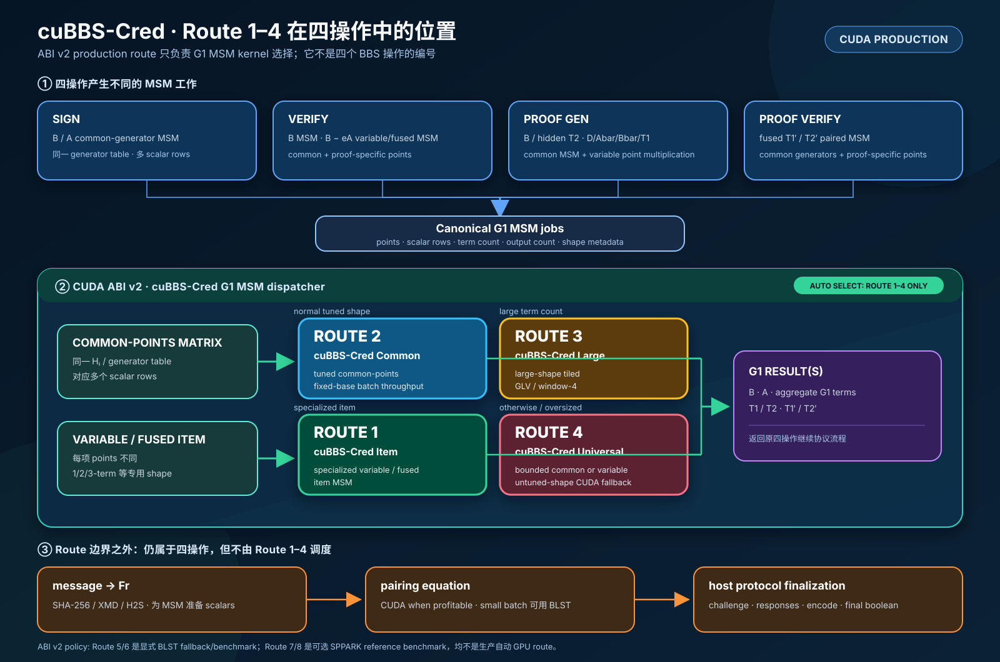

# cuBBS-Cred MSM Route 1–4 生产设计 — ABI v2

本文解释 Route 1–4 在 BBS 四操作中的真实位置、为什么需要四条生产路线、
dispatcher 如何选择路线，以及如何阅读 benchmark 中的 route telemetry。

本页合并 route registry、生产设计和矩阵模型，是路由编号与解释的统一入口。
完整操作公式见 [BBS 四操作](bbs-four-operation-cryptography.zh-CN.md)。

## 1. Route 位于系统的哪一层



可编辑图源：
[msm-routes.mmd](figures/msm-routes.mmd)。

一个 route 编号对应一次 **G1 MSM 执行策略**，不对应一个完整 BBS 操作，
也不对应 HTTP route。

下面这种理解是错误的：

```text
Route 1 = Sign
Route 2 = Verify
Route 3 = ProofGen
Route 4 = ProofVerify
```

真实组合关系是：

```text
Sign / Verify / ProofGen / ProofVerify
  → Rust host 拆解标准 BBS 操作
  → 形成一个或多个 canonical G1 MSM job
  → CUDA ABI v2 MSM dispatcher
  → 每个 job 选择 Route 1、2、3 或 4
  → 压缩 G1 结果返回原操作
  → pairing / challenge / encoding / final decision
```

因此，一个操作可能同时使用多条 route；同一条 route 也可能服务四个操作中的
多个阶段。route code 是执行 telemetry 和 benchmark metadata，不是密码学算法
编号，不改变 CFRG BBS 语义与 wire format。

## 2. 为什么按数据 shape 路由

MSM kernel 最关心的通常不是调用者叫 Sign 还是 ProofVerify，而是 points 和
scalar rows 如何排列。

### 2.1 Common-points matrix

给定同一张点表：

```text
P = [P0, P1, ... P(L-1)]
```

许多独立输出使用不同 scalar row：

```text
R0      = Σ s[0,i]   · Pi
R1      = Σ s[1,i]   · Pi
...
R(B-1)  = Σ s[B-1,i] · Pi
```

相同 ciphersuite/API_ID 和消息数的 BBS 请求可以复用
`[P1,Q1,H1,...,HL]`；issuer/header 改变 domain 等 scalar，而不是这组生成元。
点表只需解码、分 tile 或预计算一次，然后供多行 scalar
共同使用。这是 Route 2/3 最主要的结构性机会。

### 2.2 Variable/fused item

另一些 job 的 points 属于各自的 proof 或 signature：

```text
Ri = ai·Abar_i + bi·Bbar_i + di·D_i
```

虽然每项 points 不同，但 term 数与代数形态相同。专用 item/fused kernel 可以
一次处理许多小 MSM，避免每个输出单独走 generic dispatch。这是 Route 1 的目标。

### 2.3 Large 与 untuned shape

对 16–256 条消息有效的完整 fixed-base 预计算表，在 512–4096 或更大 term count
下可能消耗过多显存。大 shape 需要资源有界的 tiled kernel。

同时，专用表没有覆盖的任意合法输入仍然需要生产 CUDA 实现，不能悄悄变成
CPU 或第三方 GPU benchmark。这是 Route 3 与 Route 4 分开的原因。

统一看，Route 2 计算 `R_j = Σ_i S[j,i] P_i`；Route 3 沿 term 维度将同一
矩阵分 tile，先计算 `R[j,t]` 再归约 `R_j = Σ_t R[j,t]`；Route 1 的点为
逐行变化的 `P[j,i]`；Route 4 还允许逐行 term count 不同的 ragged 输入。
shape 与 issuer 是正交维度：mixed shape 产生多个兼容矩阵，Unique issuer
会限制 domain/prepared G2/aggregate 的复用，但不必然消除 generator 复用。

## 3. Route 1–4 的职责

| Route | 生产实现 | 典型 shape | 设计目标 |
|---:|---|---|---|
| 1 | cuBBS-Cred specialized/fused item MSM | 每项包含不同的 proof/signature-specific points；满足专用 small/fused gate | 利用重复的小 MSM 结构，消除逐项 generic dispatch |
| 2 | cuBBS-Cred tuned common-points MSM | 大量 scalar rows 共享调优过的 BBS generator table | 复用点预计算并用一次 launch 产生多个输出 |
| 3 | cuBBS-Cred large-shape tiled MSM | term count 超出常规 tuned-cache 范围的 common-points job | 用有界预计算和 tiled GLV/window-4 保持大 shape 吞吐 |
| 4 | cuBBS-Cred universal item/common fallback | 任意未调优的 common-points 或 variable-base shape | 在明确的内存预算内提供完整生产 CUDA 覆盖 |

Route 4 是 compatibility boundary，不是错误路径。

这里的 “universal fallback” 表示从 cuBBS-Cred 专用 kernel 回退到 cuBBS-Cred 通用 CUDA
kernel，而不是回退到 BLST 或 SPPARK。

## 4. Dispatcher 的输入和选择模型

进入 native dispatcher 前，Rust host 与 ABI wrapper 已经准备好：

- 压缩 G1 points 或共享 point table；
- 独立 scalar slices 或 packed row-major scalar matrix；
- `term_count` 与 `output_count`；
- 所有输出行是否共享同一组 points；
- proof pair、small fused item、common-plus-variable 等融合机会；
- 显存预算与 correctness/performance gate。

从所有权角度可以写成：

```text
if variable/fused item 满足专用 gate:
    Route 1
else if common points 属于常规 tuned shape:
    Route 2
else if common points 属于 large-shape kernel 覆盖范围:
    Route 3
else:
    Route 4
```

真实代码的 gate 比这段教学伪代码更详细。batch size、term count、内存估算、
feature flag 和 correctness gate 都会影响专用 kernel 是否允许且有收益。

阈值属于性能策略，不属于 ABI 限制。换一张 GPU 后可以重新调阈值，但不需要
改变 route 所有权，也不能改变 BBS 结果。

## 5. 四操作如何进入 Route 1–4

| 操作 | 提交给 dispatcher 的 MSM job | 可能使用的 route family |
|---|---|---|
| Sign | `B` 的 generator combination；满足条件的 scaled/final `A` preparation | common-points Route 2/3；未调优 shape Route 4 |
| Verify | `B` generator MSM；proof/signature-specific `B-eA` 或 aggregate G1 term | `B` 走 Route 2/3/4；满足条件的 variable/fused job 走 Route 1，否则 Route 4 |
| ProofGen | `B`；`T2` 的隐藏消息部分；proof-specific `D/Abar/Bbar/T1` | common 部分走 Route 2/3/4；满足条件的 variable/fused item 走 Route 1 |
| ProofVerify | paired `T1′/T2′`，同时含 common generators 与 `Abar/Bbar/D` | common 部分走 Route 2/3/4；proof-specific 部分可走 Route 1；未调优 MSM 走 Route 4 |

表中使用“可能”是刻意的：route 是在 grouping 后对每个具体 job 选择，而不是
根据操作名字静态绑定。

### 5.1 Sign 示例

同 issuer batch 可以共享：

```text
[P1, Q1, H1, ... HL]
```

消息/domain scalars 构成矩阵。常规调优 shape 可走 Route 2；大消息数可走
Route 3；两类专用集合都没有覆盖的 shape 仍通过 Route 4 留在 GPU。

### 5.2 Verify 示例

Verify 先计算 common-generator `B`，再准备 signature-specific `B-eA` 等 pairing
输入。前者可以走 Route 2/3，后者满足专用 gate 时可以走 Route 1。因此同一批
Verify 同时增加多个 route counter 是正常现象。

### 5.3 ProofGen 示例

ProofGen 同时包含两类工作：

```text
B 和 T2 的 hidden-generator 部分
    → common points

D、Abar、Bbar、T1 和 proof-specific variable term
    → variable/fused item
```

common 部分可走 Route 2/3，proof-specific 部分可走 Route 1，未调优组合由
Route 4 覆盖。

### 5.4 ProofVerify 示例

ProofVerify 重建：

```text
T1′ = c·Bbar + e_cap·Abar + r1_cap·D

T2′ = c·Bv + r3_cap·D
      + Σ hidden(m_cap[j]·H[j])
```

`H[j]` 可以在 compatible shape 内共享，而 `Abar/Bbar/D` 属于每个 proof。
paired-MSM 路径因此可以组合 common-points 与 proof-specific 执行。

生成的 `T1′/T2′` 仍需返回 host 做 challenge 与 pairing 双条件判定；MSM route
本身不决定 proof 是否有效。

## 6. 哪些阶段不属于 Route 1–4

route registry 只覆盖 G1 MSM，不包含：

- message-to-scalar SHA-256/XMD/H2S；
- public key、signature、proof、point、scalar 和 disclosed index 校验；
- transcript 构造及 challenge/response finalization；
- pairing-equation batch/aggregate kernel；
- point compression 与 signature/proof 编码；
- W3C JSON-LD/RDFC/CBOR/base64url 和 HTTP；
- 原始请求顺序恢复与 host 最终布尔判定。

其中一部分拥有独立 CUDA primitive，但不会增加 MSM route counter。因此 route
histogram 是 GPU 路径证据的一部分，不是 GPU 总利用率的完整证明。

## 7. Route 5–8 的边界

正常生产 GPU MSM 只自动选择 Route 1–4：

| Route | 实现 | 正常生产自动选择 |
|---:|---|---|
| 5 | BLST item MSM，CPU | 否；显式 fallback/对比 benchmark 入口 |
| 6 | BLST common-points MSM，CPU | 否；显式 fallback/对比 benchmark 入口 |
| 7 | SPPARK generic item Pippenger reference，GPU | 否；可选 reference build only |
| 8 | SPPARK common-points reference，GPU | 否；可选 reference build only |

cuBBS-Cred CUDA MSM 失败时必须返回错误，不能把生产 benchmark 静默切换成 CPU 或
第三方实现。更高层 BBS 操作可以对未支持的协议 shape 明确选择 CPU correctness
fallback，但该决策独立于 MSM route，必须单独记录。

普通 binary 不包含 Route 7/8。没有启用 reference build 时强制选择 7/8 应返回
错误，而不是改选其他实现。

显式 reference 测试使用 `CUBBS_BBS_MSM_BENCH_ROUTE=5`、`6`、`7` 或 `8`。
Route 7/8 还需单独构建，避免污染生产 artifact：

```bash
make -C native/cuda CUBBS_BBS_ENABLE_SPPARK_REFERENCE=1 \
  BUILD_DIR=../../target/native/cuda-reference
```

Route 8 对每个 common scalar row 调用上游 generic Pippenger，不冒充 Route 2
的固定点表缓存。历史 `CUBBS_BBS_ENABLE_SPPARK_MSM` flag 则仅启用当前
生产 kernel 所需的域/曲线模板，不能据其名字判断正在使用第三方 Pippenger。

ABI v2 采用 `CUBBS_BBS_GPU_ABI_VERSION=2` 和 `_v2` 符号，拒绝 ABI v1
动态库。更新时重建配套的 native 与 Rust 产物；历史 JSON 的 route 编号不得重写。

## 8. 如何阅读 Route telemetry

Rust 将 native route code 记录到 `BbsMsmRouteSummary`：

| Route | JSON 风格字段 | Rust 字段 |
|---:|---|---|
| 1 | `fusedItem` | `fused_item` |
| 2 | `fusedCommonPoints` | `fused_common_points` |
| 3 | `omniLarge` | `cubbs_large` |
| 4 | `omniGeneric` | `cubbs_generic` |
| 5 | `blstItem` | `blst_item` |
| 6 | `blstCommonPoints` | `blst_common_points` |
| 7 | `spparkItem` | `sppark_item` |
| 8 | `spparkCommonPoints` | `sppark_common_points` |

生产 GPU correctness run 通常应该满足：

```text
hardwareAcceleration = true
failed = 0
unknown = 0
Route 5/6/7/8 count = 0
Route 1/2/3/4 count 与测试 shape 相符
```

这些条件能证明实现所有权和成功执行，但不能单独证明 GPU 已饱和。饱和还需要：

- actual batch distribution，而不是配置的 maximum batch；
- queue wait 与 host prepare/finalize time；
- H2D、kernel、D2H timing；
- GPU active time 与 compute/memory utilization；
- stream overlap；
- 随负载增加出现稳定 throughput plateau；
- cache hit 与 operation-level fallback count。

## 9. Correctness invariant

四条生产 route 对同一合法输入必须生成与 CPU zkryptium/BLST reference 完全相同
的压缩 G1 结果。

route 不得改变：

- generator 顺序；
- scalar endian 与 Fr canonicality；
- point validation rule；
- BBS transcript 顺序；
- signature/proof wire format；
- batch 内逐项错误隔离；
- caller 可见的结果顺序。

malformed point、非法 Fr、buffer 维度溢出、allocation failure 或不可用的
reference route 都必须明确失败，不能通过无 telemetry 的实现切换“处理”。

## 10. 源码学习地图

| 设计元素 | 源码位置 |
|---|---|
| ABI version 与 route constants | `crates/cubbs-bbs/src/gpu_abi.rs` |
| Rust route summary | `crates/cubbs-bbs/src/lib.rs` 中的 `BbsMsmRouteSummary` |
| Native ABI constants | `native/cuda/include/cubbs_bbs_gpu_abi.h` |
| 生产 dispatcher | `native/cuda/src/kernels/msm_dispatch.cuh` |
| tuned/large common runtime | `native/cuda/src/kernels/common_fused_runtime.cuh` |
| universal common fallback | `native/cuda/src/kernels/common_universal.cuh` |
| universal variable fallback | `native/cuda/src/kernels/variable_base_universal.cuh` |
| correctness / benchmark acceptance | [正确性验证](testing.md)、[测试与复现](benchmarks.md) |

整套设计可以压缩为一句话：

> 标准 BBS 操作产生算术 job；数据 shape 决定 MSM route；route 只改变执行策略，
> 永远不改变密码学含义。
