# W3C HTTP service

启动、调用示例与部署边界见[运行指南](build-run-http-benchmark.zh-CN.md)；
容量测量和数据契约见[测试与复现指南](benchmarks.md)。本文集中说明端点、
请求生命周期、组批、缓存与托管模式，不复制历史性能结果。



## Endpoints and processing boundary

每个普通路径均有相同的 `/id` alias：

| Method | Path | BBS operation |
|---|---|---|
| GET | `/healthz` | 后端、队列、缓存与 timing 状态 |
| POST | `/credentials/issue`, `/credentials/issue-batch` | Sign |
| POST | `/credentials/verify`, `/credentials/verify-batch` | 根据 proofValue 分流至 Base Verify / Proof Verify |
| POST | `/credentials/derive`, `/credentials/derive-batch` | Proof Generation |

普通 `*-batch` 请求的 item 也进入操作队列；托管 bulk 的独立行为见后文。
纯 BBS 后端是 Rust library，没有另一个 `/bbs/sign` HTTP 服务。

W3C 输入先经过 JSON/options 校验、JSON-LD expansion、RDFC-1.0、
mandatory/selective 分组和 HMAC blank-node label replacement，构造
`header = proof_hash || mandatory_hash`（64 bytes），再将非 mandatory
N-Quads 作为 BBS messages。完成 BBS 后，Host 组装 CBOR/multibase proofValue
与 JSON 响应；这些工作没有因使用 GPU MSM 而被省略。

Base Verify 需重建 header 和 grouping；Derive 将 selective pointers 映射到
canonical messages 的披露索引；Proof Verify 重建披露消息与 presentation header
后执行 challenge 和 pairing 检查。JSON 属性的排列不是 BBS disclosure index。

## Queue scheduling

The cuBBS-Cred W3C service sends independent HTTP requests through four shared
queues:

```text
HTTP issue requests  -> issue queue  -> issue_jsonld_base_proof_batch
HTTP base verify     -> verify-signature queue -> verify_jsonld_base_proof_batch
HTTP derive requests -> derive queue -> derive_jsonld_disclosure_proof_batch
HTTP proof verify    -> proof-verify queue -> verify_jsonld_disclosure_proof_batch
```

The first request after an idle period can dispatch immediately. After a
pipeline slot becomes available, the worker drains ready requests up to the
operation's configured maximum batch size. A complete batch dispatches
immediately. Only a partial batch may wait for the remainder of the operation's
coalescing interval, allowing newly arriving requests to join it.
The interval is therefore a coalescing window, not a dispatch rate limiter.
Backlog beyond one complete batch remains queued for the next available
pipeline slot. Each operation also has an independent in-flight limit, while
`CUBBS_W3C_PIPELINES` caps the total number of batches across all four queues.
The two-level limit lets Verify use larger batches and fewer concurrent
submissions without allowing four queues to multiply contention on one GPU.
JSON-LD preparation, GPU work, and response assembly may overlap across
batches.

## Configuration

| Variable | Default | Meaning |
|---|---:|---|
| `CUBBS_W3C_BATCH_INTERVAL_MS` | unset | Optional global override for every operation's coalescing window |
| `CUBBS_W3C_MAX_BATCH_SIZE` | unset | Optional global override for every operation's maximum batch size |
| `CUBBS_W3C_QUEUE_CAPACITY` | `32768` | Backpressure capacity per operation queue |
| `CUBBS_W3C_PIPELINES` | `20` | Shared cap on concurrent in-flight batches across all operations |
| `CUBBS_W3C_ISSUE_{BATCH_INTERVAL_MS,MAX_BATCH_SIZE,PIPELINES}` | `5,128,20` | Issue-specific queue settings |
| `CUBBS_W3C_DERIVE_{BATCH_INTERVAL_MS,MAX_BATCH_SIZE,PIPELINES}` | `5,128,20` | Derive-specific queue settings |
| `CUBBS_W3C_VERIFY_BASE_{BATCH_INTERVAL_MS,MAX_BATCH_SIZE,PIPELINES}` | `5,512,5` | Base-signature verification queue settings |
| `CUBBS_W3C_PROOF_VERIFY_{BATCH_INTERVAL_MS,MAX_BATCH_SIZE,PIPELINES}` | `5,128,20` | Disclosure-proof verification queue settings |
| `CUBBS_W3C_GPU_VERIFY_MAX_INFLIGHT_ITEMS` | `4096` | Weighted cap on prepared base/proof Verify items simultaneously entering GPU crypto when the GPU backend is requested |
| `CUBBS_W3C_JSONLD_WORKERS` | host CPUs × 4, capped at `64` | Spawned JSON-LD preparation tasks per batch |
| `CUBBS_W3C_SHARED_JSONLD_LOADER` | `true` | Reuse one process-scoped fallback HTTP loader |
| `CUBBS_W3C_CANON_CACHE_CAPACITY` | `32768` | Bounded canonicalized-document cache; `0` disables it |
| `CUBBS_W3C_LABEL_CACHE_CAPACITY` | `min(canonical cache, 16384)` | Bounded document-and-HMAC label-replacement cache; `0` disables it |
| `CUBBS_W3C_PREPARED_CACHE_CAPACITY` | `4096` | Exact-input prepared-state entries per operation; `0` disables it |
| `CUBBS_W3C_VERIFY_CACHE_CAPACITY` | `65536` | Bounded exact-content positive-verification cache; `0` disables it |

An operation-specific variable takes precedence over its global override. The
service prints the shared cap and every active operation configuration at
startup. `/id/healthz`
returns queue depth, dispatch count, dispatched items, last/max batch size,
total queue wait, and average queue wait for all four cryptographic operations.
It also exposes cumulative JSON-LD canonicalization/cache and W3C
prepare/cryptography timings so a fast BBS kernel cannot hide a slow host
preparation path.

`CUBBS_W3C_GPU_VERIFY_MAX_INFLIGHT_ITEMS` is an admission budget rather
than another HTTP-pipeline setting. Base-signature Verify and derived-proof
Verify share it after JSON-LD/RDFC preparation completes and immediately before
their BBS crypto calls. Consequently, a high-concurrency request wave can
still be accepted and prepared through the configured W3C pipelines, while
the transient GPU MSM/pairing workspace never grows beyond the weighted item
budget. It is enabled only when `BbsBackend` parsing selects a GPU-requested
backend. CPU/no-backend runs report `verify_crypto_admission.enabled=false`,
`itemBudget=null`, and zero work/wait counters, and do not acquire permits.
The health response otherwise exposes its configured budget, current work,
high-water mark, queued work, and cumulative admission wait. When enabled,
set the item budget no lower than either effective Base Verify or Proof Verify
maximum batch size; the service rejects an invalid configuration at startup.

The default is deliberately conservative for 16 GiB GPUs: qualification on an
RTX 5060 Ti found that an 8,192-item budget can retain enough concurrent CUDA
workspace to exhaust memory under 20 pipelines, whereas 4,096 sustained
in-flight items completed without failures.  Raise this limit only after a
matching sustained-memory qualification for the target GPU and workload.

For GPU base-signature Verify batches containing two or more credentials, the
pre-B aggregate uses the dedicated dual-same-points MSM by default. This is a
bounded per-thread workspace that computes the two signature-A aggregate rows
together; it avoids retaining one persistent comb table for every transient
HTTP tail-batch cardinality. `CUBBS_BBS_GPU_VERIFY_DUAL_SAME_POINTS=0` is
reserved for diagnostic comparison, while `=1` explicitly pins this production
path in a reproducibility contract. The diagnostic fallback issues the two
dynamic rows as separate transient MSMs, so disabling the dual route cannot
populate the process-lifetime common-points cache with request-specific A
points.

Concurrent misses for the same canonicalization key are single-flighted: one
request performs JSON-LD/RDFC and concurrent waiters receive the same
intermediate result. This remains active when the long-lived canonicalization
cache is disabled, preventing a full HTTP batch from repeating an identical
issuer or proof-configuration conversion 128 times.

The prepared-state cache is also content exact and bounded. It stores protocol
preprocessing results, not signatures, proofs, or verification decisions:
W3C Issue still generates fresh HMAC label randomness and executes Sign;
every Verify/ProofVerify prepared-cache hit still invokes the BBS verifier. Its four
per-operation keys bind all inputs that affect the cached preprocessing result,
including proof options, disclosure pointers, and presentation headers.

The document and prepared caches use SHA-256 digests of the complete serialized
inputs as fixed-size keys; full JSON text is not retained as a map key. The
positive verification cache remains content exact for operational
purposes: any change to claims, contexts, or `proofValue` produces a different
digest. A credential produced by this process is registered after Issue. A
derived credential is registered only when its input base credential is already
trusted by this cache. A miss runs the normal BBS verifier, and a successful
real verification is inserted. Verification requests still pass through their
operation queue, so queue accounting remains complete on cache hits.

## Internal asynchronous request lifecycle

The public Issue, Verify, and Derive endpoints keep ordinary synchronous HTTP
semantics: one request receives its final operation result on the same
connection. Internally, each handler enqueues an item into a bounded Tokio
`mpsc` queue and awaits that item's `oneshot` receiver. This await suspends the
HTTP future; it does not block an operating-system thread. Tokio can continue
accepting requests, filling compatible micro-batches, running other pipeline
slots, and serializing completed responses.

Queue workers collect items by operation, form shape-compatible batches, and
spawn batch processors under the shared pipeline semaphore. Results are routed
back to the original handlers through their corresponding oneshot senders.
When a queue reaches its bounded capacity, `send().await` provides internal
backpressure while still yielding the Tokio worker. No public job identifier,
polling endpoint, or `202 Accepted` protocol is required.

## Batch size and cache interpretation

| 层次 | 实际含义 |
|---|---|
| HTTP payload | 一个显式 batch 请求包含的 items |
| Queue dispatch | worker 本次实际取出的独立请求 |
| W3C/BBS batch | preparation 成功后可进入相应 BBS 操作的 items |
| CUDA chunk | 按兼容 shape 和内存预算拆分后的设备工作 |

这四个大小可能不同；`c`、配置的最大 batch 和实际 CUDA batch 不能混用。
应观察 `/healthz` 的 batch-size histogram、queue wait、prepare/crypto timing，
而不是只通过客户端并发或最大 batch 参数判断 GPU 是否饱和。

结构/预处理缓存与 positive verification-result cache 不同。测量“每次请求仍执行
密码学验证”的服务容量时，必须设置 `CUBBS_W3C_VERIFY_CACHE_CAPACITY=0`，
并记录其他缓存的开关、输入工作集和命中率。缓存的有效性不取代业务层的撤销、
授权、holder binding 或 replay 检查。

GPU 请求通过 `CUBBS_BBS_REQUIRE_HARDWARE_GPU=1` 检查真实后端是否加载；
需要禁止密码学阶段 CPU fallback 时另用 `CUBBS_BBS_FORCE_GPU=1`。
AUTO 的小 shape 选择是执行策略，不应据此宣称 FORCE_GPU 无法处理该 shape。
详见[后端设计](gpu-bbs-backend-design.md)。

## Managed VC mode

Managed VC mode is an opt-in path for custody services that register credentials
before they enter the online request path. An online request identifies a
credential and, for derivation, a disclosure profile. It does not resend and
reprocess the complete VC or VP.

Enable the mode with:

```bash
CUBBS_W3C_MANAGED_VC_MODE=1
```

### Cached state

Registration performs the JSON-LD/RDFC and BBS protocol preparation once. The
store retains immutable, reference-counted state:

- a lowered `VerifyRequest` for a base credential;
- a lowered `ProofGenRequest` and W3C output template for every named
  disclosure profile;
- a lowered `ProofVerifyRequest` for a derived presentation.

This is a backend-input cache, not a verification-result cache. Every online
lookup still executes the selected BBS primitive. Replacing an identifier is
atomic; an in-flight request safely retains the previous immutable entry.

The service also retains one long-lived `BbsEngine`. Managed batches therefore
reuse the loaded CUDA library, runtime state, prepared generators, and MSM
templates instead of constructing and destroying them for every HTTP batch.

### Registration

Registration is a trusted provisioning operation:

```http
POST /managed/credentials/register
Content-Type: application/json
```

```json
{
  "credentialId": "vc-123",
  "verifiableCredential": {},
  "deriveProfiles": [
    {
      "profileId": "name-only",
      "selectivePointers": ["/credentialSubject/name"],
      "presentationHeader": []
    }
  ]
}
```

The service accepts a base VC or a derived VP. A derived VP cannot define
derivation profiles. Production deployments must place this endpoint behind the
custody service's authentication and authorization boundary.

### Online requests

Single-item operations use the operation-specific dynamic queues:

```http
POST /managed/credentials/verify
{"credentialId":"vc-123"}
```

```http
POST /managed/credentials/derive
{"credentialId":"vc-123","profileId":"name-only"}
```

Bulk operations carry a complete primitive batch in one HTTP request:

```http
POST /managed/credentials/verify-batch
{"items":[{"credentialId":"vc-123"}],"compact":true}
```

```http
POST /managed/credentials/derive-batch
{"items":[{"credentialId":"vc-123","profileId":"name-only"}],"compact":true}
```

The normal response is the complete indexed W3C result. With `compact:true`,
Verify returns a boolean vector and Derive returns only the dynamic
`proofValue` vector. The latter skips construction and serialization of a
duplicate static VP document for every batch item; the custody service can
associate each value with its registered output template.

### Capacity and scheduling

| Environment variable | Default | Meaning |
|---|---:|---|
| `CUBBS_W3C_MANAGED_VC_MODE` | `0` | Enable managed endpoints and storage |
| `CUBBS_W3C_MANAGED_VC_CAPACITY` | `50000` | Maximum registered credential IDs |
| `CUBBS_W3C_MANAGED_BULK_PIPELINES` | `6` | Concurrent complete bulk batches |
| `CUBBS_W3C_MANAGED_BULK_MAX_ITEMS` | `4096` | Maximum items accepted by one bulk HTTP request |
| `CUBBS_W3C_MANAGED_DERIVE_MAX_BATCH_SIZE` | `4096` | Single-request Derive queue batch limit |
| `CUBBS_W3C_MANAGED_VERIFY_BASE_MAX_BATCH_SIZE` | `4096` | Single-request base Verify queue batch limit |
| `CUBBS_W3C_MANAGED_PROOF_VERIFY_MAX_BATCH_SIZE` | `4096` | Single-request ProofVerify queue batch limit |

The bulk item count and pipeline count are bounded independently and exposed as
`batching.managedBulkMaxItems` and `batching.managedBulkPipelines` in
`/healthz`. Six pipelines is a tunable default, not a saturation guarantee for every
workload. Measure the target GPU, memory consumption and latency before
increasing concurrency.

## Source map

- HTTP handlers, operation queues, managed store: `crates/cubbs-w3c-service/src/main.rs`.
- W3C processing and exact-input preprocessing caches: `crates/cubbs-vc-di-bbs/src/`.
- Proof-value encoding: `crates/cubbs-bbs-proofvalue/src/`.
- BBS batching, planner and CUDA ABI: `crates/cubbs-bbs/src/`.
